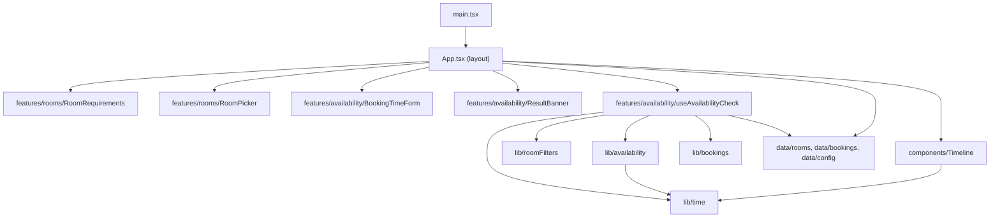

# Assignment 04 Report: Smart Campus Room Availability

## Summary

The project is a React and TypeScript room availability checker. This report covers codebase analysis, the room filtering implementation, architecture, the test strategy with exact test names and results, a before and after quality comparison, and a draft reflection.

Verification performed for this report (run after all documentation was written):

- `npx vitest run`: 78 tests passed in 6 files.
- `npm run typecheck`: passed.
- `npm run lint`: passed.
- `npm run build`: passed.

Browser manual verification was **not** performed. No check in this report was done in a real browser. The UI tests run the app in jsdom, a simulated browser environment.

---

## Task 1: Codebase Analysis

### Maintainability risks

| # | Risk | Evidence | Impact |
| --- | --- | --- | --- |
| R1 | Stale-result reset is manual. Each input handler calls `setResult(null)` separately, so a new control that forgets to do this would show an outdated result. | `src/features/availability/useAvailabilityCheck.ts`: `updateAttendees`, `toggleEquipment`, `updateStartTime`, `updateEndTime`, `updateCurrentTime` | Incorrect results shown after a change |
| R2 | Business constants are repeated. The 120-minute limit appears in logic and in UI text. The 1440-minute day length appears in logic, the timeline, and the slider. | `src/lib/availability.ts` (`end - start > 120`), `src/features/availability/BookingTimeForm.tsx` (text "Max booking duration: 120 minutes", slider `max={1440}`), `src/components/Timeline.tsx` (`/ 1440`) | Changing a rule means editing several files, and the text can drift from the logic |
| R3 | Form labels are not linked to their inputs in the booking time form. Labels have no `htmlFor` and the inputs have no `id`. | `src/features/availability/BookingTimeForm.tsx` | Weaker accessibility; tests must query inputs by position (the UI tests use `querySelectorAll`) |
| R4 | An unused dependency. `@supabase/supabase-js` is listed in `package.json`, but no source file imports it. | `package.json`; no `supabase` references under `src/` | Extra install weight and a misleading signal about the architecture |
| R5 | The hook holds state and also makes domain decisions (`buildResult`). The filter-and-select flow can only be exercised through React. | `src/features/availability/useAvailabilityCheck.ts` | Hard to unit test; the integration test copies this flow (see Task 4) |
| R6 | Fixture access is split. `App.tsx` imports `bookings` directly, and the hook imports the same fixture separately. | `src/App.tsx`, `src/features/availability/useAvailabilityCheck.ts` | Two access points that must stay consistent |

### Prioritized improvement plan

1. **High: link labels to inputs (R3).** Add `id` and `htmlFor` pairs in `BookingTimeForm.tsx`. This is low risk and makes the UI tests use accessible queries.
2. **High: one source for business constants (R2).** Define the 120-minute maximum and the 1440-minute day in one module, and reuse it in the logic, the timeline, the slider, and the hint text.
3. **Medium: centralize the stale-result reset (R1).** Route all input changes through one helper that clears the result.
4. **Medium: move the filter-and-select derivation into a pure function in `src/lib/` (R5, R6).** The hook and the integration test would then share one implementation, and the copy in the test would be removed.
5. **Low: decide on the unused Supabase dependency (R4).** Remove it, or keep it deliberately for a future backend. This needs the project owner's decision.

None of these changes were made in this session, because the task was limited to documentation and application code was not to be changed.

### AI suggestion rejected or modified

- **Rejected:** Refactoring the hook to expose a pure function so it could be unit tested directly. The task required no change to production behavior, so the integration test mirrors the flow instead. Trade-off: the flow logic exists in two places (R5).
- **Modified:** The first response declined to install testing libraries and proposed an alternative. After the user approved installing `@testing-library/react`, `@testing-library/dom`, and `jsdom`, jsdom was enabled per test file with a `// @vitest-environment jsdom` comment instead of changing the global Vitest configuration. This keeps the existing tests in the default environment.

---

## Task 2: Room Capacity and Equipment Filtering

### Implemented behavior

The requirements panel (`src/features/rooms/RoomRequirements.tsx`) collects the attendee count and the required equipment. `src/features/availability/useAvailabilityCheck.ts` applies the filters, and `src/features/rooms/RoomPicker.tsx` shows the result.

| Behavior | Rule implemented in `src/lib/roomFilters.ts` | Tests |
| --- | --- | --- |
| Capacity match | A room is kept when `room.capacity >= attendees`. | `includes a room whose capacity exactly matches the requirement`, `includes rooms with greater capacity than the requirement` |
| Empty attendee field | Treated as 0, so every room passes the capacity filter. | Conversion happens in `useAvailabilityCheck.ts`; no test checks this case directly |
| Invalid attendee number | `NaN` or infinite values return no rooms. | `returns an empty list for a NaN or infinite requirement` |
| Negative attendee number | Treated as 0. | `treats a negative requirement as zero, so every room qualifies` |
| Equipment match | A room is kept only if it has every selected item (AND logic). No selection keeps all rooms. | `returns rooms containing all required equipment`, `excludes a room that is missing one required equipment item`, `returns all rooms when no equipment is selected` |
| Case-insensitive equipment | Item names are compared in lower case. | `matches equipment case-insensitively` |
| Combined filters | Capacity is applied first, then equipment. | `applies capacity and equipment filters together` |
| No matching rooms | The picker shows "No rooms match your selected requirements." | Covered by integration test `I04` (no room matches) |
| Selection fallback | If the selected room is filtered out, the first remaining room is selected. | `useAvailabilityCheck.ts` (`find(...) ?? filteredRooms[0] ?? null`); no dedicated test |
| Blocked rooms | Blocked rooms stay in the list with a "Blocked" badge; the availability check rejects them. | `U02`, `I03` |

**F1 to F5:** The project files contain no definitions of F1 to F5. The table above lists the behaviors that are implemented and tested. Map them to the F-numbering in the assignment brief, which was not available in the workspace.

---

## Task 3: Architecture

### Current architecture (as implemented)

The app has no separate "before" snapshot in the workspace, so only the current structure is diagrammed here. The pre-refactoring structure should be added from the project's own history.

### Extracted modules

| Module | Responsibility |
| --- | --- |
| `src/lib/availability.ts` | Pure check of a requested interval against the rules and existing bookings |
| `src/lib/roomFilters.ts` | Pure capacity and equipment filters |
| `src/lib/bookings.ts` | Pure selection of one room's bookings |
| `src/lib/time.ts` | Conversion between `HH:MM` text and minutes |
| `src/features/availability/useAvailabilityCheck.ts` | Page state and wiring of the pure functions |
| `src/features/availability/*` | Time form and result display |
| `src/features/rooms/*` | Requirements inputs and room list |
| `src/components/Timeline.tsx` | Timeline rendering |
| `src/data/*` | Fictional rooms, bookings, and default current time |

### Design decisions and trade-offs

1. **Pure functions in `src/lib/` with explicit parameters.** `checkAvailability` takes the room, the bookings, and the current time as arguments. *Benefit:* each rule is tested without React. *Trade-off:* the hook must do the wiring, and that wiring is only tested through the UI.
2. **One hook owns the page state.** `useAvailabilityCheck` holds all inputs and the result. *Benefit:* one place to read the state flow. *Trade-off:* the hook mixes state with decisions (R5), so the flow is harder to test in isolation.
3. **Static, in-memory fixtures.** Rooms and bookings live in `src/data/`. *Benefit:* no backend is needed, which matches the project's "no backend, login or booking creation" constraint. *Trade-off:* nothing persists, and the app cannot create bookings.
4. **jsdom enabled per test file.** UI test files opt in with a docblock. *Benefit:* the existing tests keep the default environment. *Trade-off:* each new UI test file must repeat the comment.

---

## Task 4: Test Strategy

### Levels

| Level | Files | Count | Environment |
| --- | --- | --- | --- |
| Unit | `src/lib/*.test.ts` | 70 | Node (Vitest default) |
| Integration | `src/features/availability/availabilityFlow.test.ts` | 4 | Node; runs the filter, selection, and availability functions on the real fixtures without rendering React |
| UI | `src/App.test.tsx` | 4 | jsdom; renders the real `App` and drives it with clicks and input changes via React Testing Library |
| **Total** | **6 files** | **78** | |

Per-file counts were taken from the test sources: `availability.test.ts` 24, `bookings.test.ts` 8, `roomFilters.test.ts` 12, `time.test.ts` 26, `availabilityFlow.test.ts` 4, `App.test.tsx` 4. The sum is 78.

### UI and integration tests (exact names)

- `U01 — filtering by 20 attendees and Whiteboard, then choosing Room B-204, shows it available for 11:00–12:00`: selects attendees, an equipment checkbox, and a room, then clicks "Check Availability" and expects "Available" with the 11:00–12:00 message.
- `U02 — a blocked room shows an Unavailable result with the Room Blocked reason`: selects blocked Lab C-310 and expects "Unavailable" and "Room Blocked".
- `U03 — switching the selected room after a check updates the displayed result`: a 12:00–13:00 check on Room A-101 shows "Unavailable" with "Time Overlap"; switching to Room B-204 shows "Available".
- `U04 — changing a requirement clears the previous result until the user checks again`: after a check, changing the attendee count removes the result banner.
- `I01 — 20 attendees with Whiteboard lists Room A-101, B-204 and D-105; B-204 at 11:00–12:00 is available`
- `I02 — Room A-101 at 12:00–13:00 is unavailable with a time overlap naming the Physics Lab booking`
- `I03 — 10 attendees with Computers lists blocked Lab C-310, and checking it is unavailable as room-blocked`
- `I04 — 50 attendees with Laboratory Equipment matches no room, leaving nothing to select`

### Unit test names

All 70 unit tests (click to expand)

**`src/lib/availability.test.ts` (24)**
- T01 — 660–720 is available (touches existing 600–660 at its end)
- T02 — 540–570 is unavailable when start equals current time
- T03 — 720–720 is unavailable (zero-duration interval)
- T04 — 750–720 is unavailable (end before start)
- T05 — 1380–1441 is unavailable (end exceeds 1440)
- T06 — 720–840 is available (duration exactly 120 minutes)
- T07 — 720–841 is unavailable (duration 121 minutes)
- T08 — 570–600 is available (touches existing 600–660 at its start)
- T09 — 630–690 is unavailable (partial overlap with 600–660)
- T10 — 570–690 is unavailable (contains existing 600–660)
- T11 — 615–645 is unavailable (inside existing 600–660)
- T12 — 600–660 is unavailable (exact same interval as existing)
- T13 — 660–720 is unavailable when room is blocked
- T14 — 630–690 is available when there are no existing bookings
- T15 — 720–840 is available and existingBookings is unchanged after the call
- T16 — 630–690 on room-1 is available when the 600–660 booking belongs to room-2
- T17 — 1320–1440 is available (end exactly 1440, duration exactly 120)
- T18 — -30 to 30 is unavailable (negative start time)
- T19 — 0 to 60 is available when currentTime is before 0 (start at midnight boundary)
- T20 — 541 to 600 is available (start is exactly 1 minute after current time)
- T21 — 830–870 is unavailable (overlaps the second of two bookings)
- T22 — 630–690 is unavailable (overlaps the first of two bookings)
- T23 — 500–560 is unavailable when current time is 540 (start in the past)
- T24 — sample fixtures: 600–660 touching r1's 540–600 is allowed, blocked r3 is rejected, and fixtures are unchanged

**`src/lib/bookings.test.ts` (8)** under `getRoomBookings`
- returns only bookings whose roomId matches
- returns an empty array when no booking matches the room
- returns an empty array when the bookings list is empty
- returns every booking when all belong to the room
- preserves the original order of matching bookings
- does not mutate the original bookings array
- returns a new array instance rather than the input array
- does not match when roomId differs only by case

**`src/lib/roomFilters.test.ts` (12)**
- `filterByCapacity`: includes a room whose capacity exactly matches the requirement; includes rooms with greater capacity than the requirement; returns an empty list when no room has enough capacity; returns an empty list when the room list is empty; returns an empty list for a NaN or infinite requirement; treats a negative requirement as zero, so every room qualifies
- `filterByEquipment`: returns all rooms when no equipment is selected; returns rooms containing all required equipment; excludes a room that is missing one required equipment item; matches equipment case-insensitively
- `room filter inputs`: leaves the original room array and its rooms unchanged; applies capacity and equipment filters together

**`src/lib/time.test.ts` (26)**
- `formatTime` (10): formats midnight as 00:00; formats a typical afternoon-style value; pads single-digit hours and minutes; formats the last whole minute of the day; wraps 1440 (end of day) to 00:00; wraps minutes beyond one day back into the 24-hour cycle; formats the hour 59 boundary before the next hour; does not round fractional minutes; returns NaN text for NaN input; returns a sign-prefixed string for negative input
- `parseTime` (15): parses midnight as 0; parses a typical value; parses the last valid minute of the day; accepts a single-digit hour; accepts a zero-padded single-digit hour; rejects hour 24 even though formatTime(1440) is 00:00; rejects minutes of 60; rejects a single-digit minute value; rejects a three-digit hour; rejects a negative hour; rejects an empty string; rejects leading or trailing whitespace; rejects a separator other than a colon; rejects values with extra segments; rejects non-numeric text
- `formatTime and parseTime together` (1): parseTime reverses formatTime for every whole minute of the day

### Acceptance criteria coverage

The project does not contain a full written list of AC1 to AC6. The following mapping uses the criteria as cited in the code comments in `src/lib/availability.ts` and `src/lib/availability.test.ts`.

| Criterion (as cited in code) | Tests |
| --- | --- |
| AC1: valid range, ordering, and start after current time | T02, T03, T04, T05, T18, T19, T20, T23 |
| AC2: maximum 120-minute duration | T06, T07, T17 |
| AC3: blocked rooms are rejected | T13, T24, U02, I03 |
| AC4: overlaps rejected, touching endpoints allowed | T01, T08 to T12, T16, T21, T22, I02, U03 |
| AC5 to AC6: inputs are not mutated | T15, T24, `does not mutate the original bookings array`, `leaves the original room array and its rooms unchanged` |

### Commands and actual results

| Command | Result |
| --- | --- |
| `npx vitest run` | 78 passed (78), 6 files passed |
| `npm run typecheck` | Passed (no errors) |
| `npm run lint` | Passed (no errors) |
| `npm run build` | Passed |

These results come from the final run for this report. The browser was not used.

### Gaps

- No coverage measurement was run, so no coverage percentage is claimed.
- `useAvailabilityCheck` has no direct test. Its flow is covered through the UI tests, and `availabilityFlow.test.ts` copies part of its logic.
- The formatting tests lock in the current output for invalid input (`formatTime(NaN)` returns `"NaN:NaN"`). This documents existing behavior rather than a deliberate design.

---

## Task 5: Before and After Quality Comparison

Baseline: the project as found at the start of this session, with 70 tests in 4 files. The number 24 in the brief matches only `availability.test.ts`; the full baseline was 70.

| Dimension | Before (70 tests, 4 files) | After (78 tests, 6 files) |
| --- | --- | --- |
| Test levels | Unit only, all in `src/lib/` | Unit (70), integration (4), UI (4) |
| Components tested | None | `App` (rendered, with user interaction) |
| Environments | Node only | Node and jsdom (per file) |
| Dependencies added | None | `@testing-library/react`, `@testing-library/dom`, `jsdom` (dev only) |
| Test helper duplication | `makeBooking` in `availability.test.ts` and `bookings.test.ts`; `makeRoom` in `availability.test.ts` and `roomFilters.test.ts` | Unchanged; `availabilityFlow.test.ts` adds `searchRooms` and `checkRoom` |
| Logic duplication | None between tests and app | The filter-and-select flow is copied into `availabilityFlow.test.ts` (R5) |
| Production code changes | Not applicable | None in this session |

### Remaining limitations

- Test helpers are duplicated across unit test files.
- The integration tests do not exercise the real hook; they copy its flow.
- There is no browser-level (end-to-end) test and no manual browser check.
- The business constants are still repeated across files (R2).
- Accessibility of the time form is incomplete (R3).

---

## Task 6: Reflection (Draft for Student Review)

> **Draft for the student to review and personalize.** It is based on the work recorded in this project and must be rewritten in your own voice before submission.

When I was asked for a UI test, the project had no testing library or browser-style environment installed. Instead of adding packages on my own, I explained the limitation and offered a smaller alternative: an integration test that runs the same filter and availability sequence on the real data without rendering the page. I wrote that test first. You approved the additional packages, and only then did I write the UI tests that render the real app and click through it.

Each change was checked by running the full test suite, type checking, lint, and the production build. I also learned that a passing test count is not proof of behavior. My first tally of tests in this session was off, and I corrected it only after counting the tests in each file. The integration test copies part of the hook's logic, so it could drift from the real code. I accepted that trade-off because the task forbade changing application code.

I would not rely on the AI's summary alone. Next time I would check the real interaction in a browser, which this project has not yet had done, and I would move the shared logic into a function that both the app and the tests can call.

---

## Limitations of This Report

- Browser manual verification was **not** completed.
- The pre-refactoring architecture and the F1 to F5 definitions were not available in the workspace.
- No coverage, performance, or accessibility audit was run.
